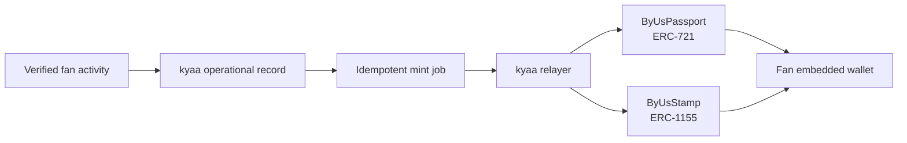

<p align="center">
  <a href="https://kyaa.io/?locale=en">
    
  </a>
</p>

<h1 align="center">kyaa Contracts</h1>

<p align="center">
  Non-transferable fan identity and participation credentials on GIWA Sepolia.
</p>

<p align="center">
  <a href="https://github.com/kyaa-io/kyaa-contracts/actions/workflows/contracts.yml"></a>
  
  <a href="LICENSE"></a>
  <a href="https://docs.giwa.io/giwa-chain/en/"></a>
</p>

kyaa turns verified fan activity into durable credentials. A fan receives a creator-specific Passport after verification, then collects Stamps through LIVE reservations, attendance, and surveys.

The contracts make those records publicly verifiable without making them tradable.

## Contracts

| Contract | Standard | Purpose |
| --- | --- | --- |
| [`ByUsPassport`](src/ByUsPassport.sol) | ERC-721 | One creator-specific fan identity credential per `passportId` |
| [`ByUsStamp`](src/ByUsStamp.sol) | ERC-1155 | One participation credential per `issuanceId` |

Both contracts are:

- **soulbound** — approvals and transfers are disabled;
- **idempotent** — each non-zero business identifier can be minted only once;
- **role-controlled** — minting, pausing, and delayed admin transfer are separated;
- **pausable** — an authorized operator can stop and resume issuance;
- **non-upgradeable** — deployed behavior cannot be replaced through a proxy;
- **metadata-stable** — no public method changes the URI after minting.

## Credential model



The contracts store an opaque `bytes32` business identifier and an immutable metadata URI. The kyaa application keeps fan identity, activity logs, score, benefits, and fulfillment data off-chain.

## Security model

### Role separation

| Role | Capability |
| --- | --- |
| `DEFAULT_ADMIN_ROLE` | Delayed role administration |
| `MINTER_ROLE` | Issue Passport or Stamp credentials |
| `PAUSER_ROLE` | Pause and resume minting |

The default-admin transfer delay is two days. The deployment script accepts separate admin and relayer addresses.

### Soulbound behavior

- Passport `approve`, `setApprovalForAll`, and post-mint transfers revert.
- Stamp `setApprovalForAll`, single transfers, and batch transfers revert.
- Neither contract exposes a public burn function.

### What these contracts do not contain

- payment or treasury logic;
- a tradable token;
- royalties;
- a token economy;
- upgradeability;
- on-chain fan PII;
- a claim of external audit.

## Existing ByUs deployment

These deployed contracts retain their verified source names, token names, addresses, and metadata. The repository brand is kyaa; this does not rename already issued credentials.

Network: **GIWA Sepolia** · Chain ID: **91342**

| Contract | Address | Deployment |
| --- | --- | --- |
| ByUsPassport | [`0x17f9FB7658A326DD88dB523739c227faf50Fca20`](https://sepolia-explorer.giwa.io/address/0x17f9FB7658A326DD88dB523739c227faf50Fca20) | [`0xed05…f689`](https://sepolia-explorer.giwa.io/tx/0xed05fe63e0e7a68f556f908a2cfa59f67bd4d48c65ad7ce4c7da3ad57e679689) |
| ByUsStamp | [`0x1AdCdE3473c4e884E60205b397ecE744D8892285`](https://sepolia-explorer.giwa.io/address/0x1AdCdE3473c4e884E60205b397ecE744D8892285) | [`0x8171…0190`](https://sepolia-explorer.giwa.io/tx/0x817130af51218431d2dc913f96a0d939d0aea62ea30339d2c5771d034d100190) |

Canonical deployment metadata and compiled runtime hashes are recorded in [`deployments/giwa-sepolia.json`](deployments/giwa-sepolia.json).

### Verified activity

- [Successful Fan Passport mint](https://sepolia-explorer.giwa.io/tx/0x7574bdeb18ca5ecfcffcbc581cad353e9bfdff69d7f3c792d3add471f54c504e)
- [Successful participation Stamp mint](https://sepolia-explorer.giwa.io/tx/0x4c3bcf6e47388b30c289bf83c468f67fb2047799b47e31b5181e83c44c5ef627)

> This is a testnet deployment. It is not a mainnet or independent-audit claim.

## Quick start

### Requirements

- [Foundry](https://getfoundry.sh/)
- Git with submodule support

```bash
git clone --recurse-submodules https://github.com/kyaa-io/kyaa-contracts.git
cd kyaa-contracts

forge build
forge test
```

If the repository was cloned without submodules:

```bash
git submodule update --init --recursive
```

## Test and verify

```bash
forge fmt --check
forge build --sizes
forge test -vvv
scripts/check-runtime-hashes.sh
```

The current test suite covers:

- separated admin, pauser, and minter roles;
- unique Passport and Stamp issuance;
- zero identifiers and recipients;
- blocked approvals, transfers, and batch transfers;
- unauthorized minting and pausing;
- pause, unpause, and mint recovery;
- event arguments;
- fuzzed Passport identifier uniqueness.

To compare the public deployment with this repository:

```bash
scripts/verify-giwa-sepolia.sh
```

The script verifies chain ID `91342`, fetches runtime bytecode from GIWA Sepolia, and compares its Keccak-256 hash with the committed deployment manifest.

## Deploy safely

Copy the public environment template:

```bash
cp .env.example .env
```

Set the RPC URL and the public admin and relayer addresses. Keep deployment credentials in a Foundry keystore rather than a plaintext environment variable:

```bash
cast wallet import byus-deployer --interactive

forge script script/DeployByUs.s.sol:DeployByUs \
  --rpc-url "$GIWA_RPC_URL" \
  --account byus-deployer \
  --broadcast \
  --verify \
  --verifier blockscout \
  --verifier-url "$BLOCKSCOUT_API_URL"
```

Never commit a private key, mnemonic, populated `.env`, or raw signed transaction.

## Repository structure

```text
src/                        Passport and Stamp contracts
test/                       Foundry unit and fuzz tests
script/                     Keystore-compatible deployment script
deployments/                Canonical public deployment manifests
scripts/                    Local and live bytecode verification
.github/workflows/          Formatting, build, test, and hash CI
```

## Integration notes

kyaa uses a database-first, asynchronous minting pipeline:

1. a fan action commits the operational record and idempotent job;
2. a worker builds PII-free credential metadata and pins it to IPFS;
3. the relayer prepares and persists the signed transaction before broadcast;
4. the worker broadcasts the same bytes on retry;
5. the receipt and mint event reconcile the credential to `minted`.

The application database—not the chain—is the operational source of truth for fan activity, score, benefit eligibility, and claim delivery.

## Related projects

- [kyaa application](https://github.com/kyaa-io/kyaa)
- [kyaa Developer Documentation](https://github.com/kyaa-io/kyaa-docs)
- [Live product](https://kyaa.io/?locale=en)
- [GIWA Documentation](https://docs.giwa.io/giwa-chain/en/)

## Security

Please read [SECURITY.md](SECURITY.md) before reporting a vulnerability.

## License

The contracts are available under the [MIT License](LICENSE).

## New kyaa credentials

`KyaaPassport` exposes `kyaa Fan Passport` / `KYAAPASS`; `KyaaStamp` preserves the existing ERC-1155 behavior. Both reuse the original access control and non-transferability. Existing ByUs deployments and token metadata remain unchanged.

Run `FOUNDRY_PROFILE=kyaa forge test` for the new compiler profile (Solidity 0.8.28, optimizer runs 0, via IR). The reviewed Hub upgrade, deployment manifest and migration controls live in [kyaa](https://github.com/kyaa-io/kyaa); new issuance activates only after its Timelock and route verification.
